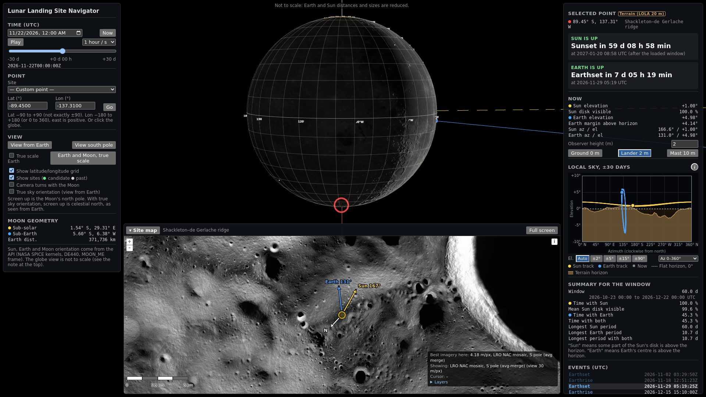
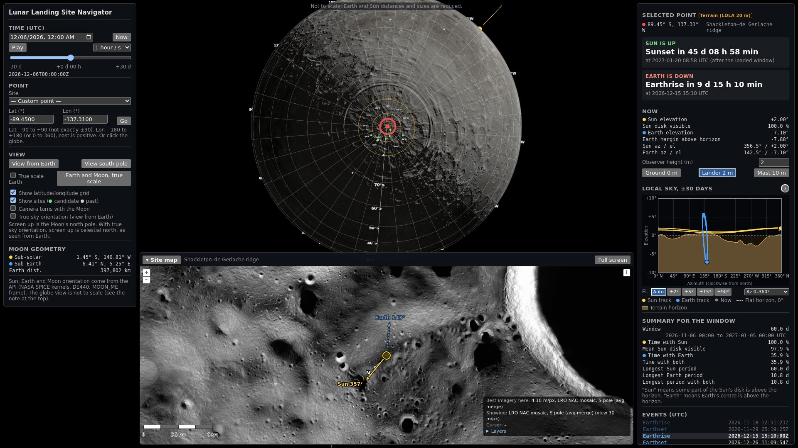

# Lunar Landing Site Navigator

Live tool: **https://lunarsite.select**

This project is an entry for the NASA Space Apps Challenge 2026, challenge [Lunar Landing Site Navigator](https://www.spaceappschallenge.org/2026/challenges/lunar-landing-site-navigator/).

The tool compares lunar landing sites and dates. For one point on the Moon, it shows where the Sun and Earth are relative to the local horizon. It tells you the time to the next sunset and the next Earthset. Thus you can estimate solar power and direct-to-Earth communication at a site. The focus is the lunar south pole.

The users are mission planners, educators and the public. A planner can check a site and a date in a few seconds. A student can see why the south pole is difficult: there, the Sun and Earth stay near the horizon, and terrain can hide them.



## Contents

1. [What you can do](#what-you-can-do)
2. [Example: a two-week launch slip](#example-a-two-week-launch-slip)
3. [Challenge objectives](#challenge-objectives)
4. [How it works](#how-it-works)
5. [Data sources and credits](#data-sources-and-credits)
6. [Validation](#validation)
7. [Run it locally](#run-it-locally)
8. [Repository layout](#repository-layout)
9. [Limitations](#limitations)
10. [Use of AI](#use-of-ai)
11. [License](#license)

## What you can do

- **Select a point.** Pick one of 22 curated sites, type a latitude and longitude, or click the globe or the map. The curated sites are 15 past landings (Apollo, Chang'e, Chandrayaan-3, SLIM, IM-1, IM-2 and Blue Ghost Mission 1) and the 7 Artemis III candidate regions.
- **Select a time.** Type a UTC date and time, or move the slider over ±30 days. "Play" animates the time at 1 minute to 1 day per second.
- **Read the countdowns.** The results panel tells you if the Sun and Earth are up. It gives the time to the next sunset or sunrise, and to the next Earthset or Earthrise.
- **Read the values.** The panel shows the Sun elevation, the part of the Sun's disk that is visible, and the Earth elevation. "Earth margin" is the Earth elevation minus the terrain horizon elevation in the Earth direction.
- **Read the summary.** For the ±30-day window, the panel shows the time with the Sun, with Earth and with both. It also shows the longest period of each. The panel lists all sunrise, sunset, Earthrise and Earthset events.
- **See the local sky.** The sky plot shows the Sun and Earth tracks over the window, with the terrain horizon outline. You can zoom to ±2° to see the true disk sizes.
- **See the site.** The site map shows NASA Moon Trek images of the site, with arrows to the Sun and Earth.
- **See the geometry.** The 3D globe shows the Moon's orientation, the lit half, the sub-solar point and the sub-Earth point. "Earth and Moon, true scale" shows Earth at its true distance and size.
- **Change the observer height.** Use 0 m (ground), 2 m (lander) or 10 m (mast), or type a value.

Definitions:

- **Terrain horizon:** the elevation angle of the highest terrain in each direction, as seen from the observer. The tool calculates it from LOLA elevation data.
- **Sun up:** some part of the Sun's disk is above the horizon.
- **Earth up:** the centre of Earth is above the horizon.

## Example: a two-week launch slip

All values in this section come from the deployed API on 2026-11-14. The observer is 2 m above the ground. The horizon is the LOLA terrain horizon.

A mission plans to land on 2026-11-22 and to operate for 7 days. Then the launch slips by 2 weeks, to 2026-12-06. The planner compares three south-pole sites over 7 days from each start date (API, 30-minute steps):

| 7 days from | Site | Time with Sun | Time with Earth | Time with both |
|---|---|---|---|---|
| 2026-11-22 | Shackleton–de Gerlache ridge (89.45° S, 137.31° W) | 100 % | 100 % | 100 % |
| 2026-11-22 | Malapert Massif | 100 % | 100 % | 100 % |
| 2026-11-22 | de Gerlache Rim | 100 % | 100 % | 100 % |
| 2026-12-06 | Shackleton–de Gerlache ridge | 100 % | 0 % | 0 % |
| 2026-12-06 | Malapert Massif | 100 % | 0 % | 0 % |
| 2026-12-06 | de Gerlache Rim | 0 % | 0 % | 0 % |
| 2026-12-16 | Shackleton–de Gerlache ridge | 100 % | 100 % | 100 % |
| 2026-12-16 | Malapert Massif | 70.9 % | 100 % | 70.9 % |
| 2026-12-16 | de Gerlache Rim | 100 % | 100 % | 100 % |

After the slip, Earth is below the terrain horizon at all three sites. Thus direct-to-Earth communication without a relay satellite is not possible for the first week. On 2026-12-06 at 00:00 UTC, the tool shows this for the ridge:

- Sun: up, at +2.00°. The next sunset is after the 60-day window (2027-01-20 08:58 UTC).
- Earth: down, at −7.10°. The Earth margin is −7.88°. "Earthrise in 9 d 15 h 10 min", at 2026-12-15 15:10 UTC.

At de Gerlache Rim on the same date, the Sun is at +1.76°. But the terrain horizon in the Sun direction is at +5.04°. Thus the terrain hides the Sun. A flat horizon would show the Sun as up.

The planner moves the landing to 2026-12-16. At the ridge, the Sun and Earth are then both up for all 7 days. "Earthset in 10 d 11 h 09 min", at 2026-12-26 11:09 UTC. The Earth margin at 00:00 UTC is only +0.52°. Earth's disk has a radius of about 0.95°, so part of the disk is below the terrain at that instant.



More screenshots are in [`docs/submission/screenshots/`](docs/submission/screenshots/).

## Challenge objectives

The challenge page lists seven objectives. This table tells how the tool meets each one.

| Objective | How the tool meets it |
|---|---|
| Interactive site selection and comparison | 22 curated sites with sources, typed coordinates, and clicks on the globe or the map. You compare sites one after the other. There is no side-by-side view. |
| Date and time flexibility | Date and time input, a ±30-day slider, and "Play". Each new date loads a new 60-day window. |
| Sun and Earth position visualization | Local sky plot (azimuth and elevation) with the terrain horizon, Sun and Earth arrows on the site map, and the 3D globe. Countdowns to the next sunset and Earthset. |
| Power and communication assessment | Sun elevation, visible part of the Sun's disk, time with the Sun, Earth margin, time with Earth, time with both, and the longest periods. |
| Multiple visualization approaches | 3D globe (three.js), 2D site map (OpenLayers), and the sky plot. |
| Temporal dynamics | Time animation, Sun and Earth tracks over ±30 days, and the event list. |
| Accessibility across skill levels | Plain-language help in the sky plot, presets for the observer height, and a public API with an interactive schema for technical users. |

The challenge also names some technical points:

- **Ephemeris.** The tool uses NASA NAIF SPICE with the JPL DE440 ephemeris. The results agree with JPL Horizons (see [Validation](#validation)).
- **Topography.** The horizon comes from LOLA elevation data south of about 65° S.
- **No atmosphere.** There is no refraction model. The horizon is the terrain, or a flat 0° horizon where there is no terrain data.
- **Libration.** The lunar orientation comes from the DE440 high-accuracy lunar orientation kernel. Thus libration is included. The Earth direction is topocentric, so Earth's parallax (up to about 0.26°) is also included.

## How it works

```text
            Browser
   ┌──────────────────────────────────────────────┐
   │ 3D globe (three.js)   sky plot   results     │
   │ site map (OpenLayers) ──────────────────────────► NASA Moon Trek tiles
   └───────────────┬──────────────────────────────┘     (trek.nasa.gov)
                   │ static files        │ JSON over HTTPS
                   ▼                     ▼
   ┌───────────────────────┐   ┌─────────────────────────────────┐
   │ lunarsite-ui          │   │ lunarsite-api                   │
   │ Cloud Run, nginx      │   │ Cloud Run, FastAPI              │
   │ Vite + TypeScript     │   │  ├─ lunarnav: SPICE, DE440,     │
   └───────────────────────┘   │  │   MOON_ME frame              │
                               │  └─ lunarterrain: LOLA DEMs     │
                               │      → horizon masks            │
                               └─────────────────────────────────┘
```

**UI.** The UI is a static web app (Vite, TypeScript, three.js and OpenLayers). It runs on Google Cloud Run behind nginx. It gets all geometry from the API. It does not calculate positions itself.

**API.** The API is a FastAPI app on Google Cloud Run. One call to `POST /v1/series` returns a full time span for one point. The response has the Sun and Earth positions at each step, the events and a summary. It also has the horizon and the next events after the span. A 60-day series at 60-minute steps took about 0.4 s in one test on 2026-11-14 (time from request to response). The interactive schema is at https://lunarsite-api-763981639147.europe-west1.run.app/docs.

| Endpoint | Purpose |
|---|---|
| `POST /v1/series` | Sun and Earth positions, visibility, events and summary at one point over a time span |
| `POST /v1/moon-state` | Sub-solar and sub-Earth points and the Moon orientation at each step |
| `GET /v1/mask` | Terrain horizon mask at one point |
| `GET /v1/sites` | The curated site list |
| `GET /v1/health` | Status |

**Core (`lunarnav`).** The Python package `lunarnav` uses SPICE through `spiceypy`. SPICE is the NASA NAIF toolkit for the positions and orientations of solar system bodies. For one point and one instant, `lunarnav` calculates the azimuth and elevation of the Sun and Earth. The directions are apparent: they include light time and stellar aberration. The frame is `MOON_ME` (Moon Mean Earth / Polar Axis), the frame of lunar maps and LOLA data. Then `lunarnav` compares each direction with the horizon mask. It finds the events by bisection between time steps.

**Terrain (`lunarterrain`).** The Python package `lunarterrain` calculates a horizon mask from two LOLA elevation models. A mask gives the horizon elevation at each 0.5° of azimuth. For each azimuth, the tool samples the terrain along a 150 km line from the point. The step is 10 m near the point and up to 500 m far away. The near field (25 km or less) uses the 20 m/pixel model. The far field uses the 120 m/pixel model. The calculation includes the curvature of the Moon. One new mask takes about 0.6 s.

On 2026-11-14, the deployed API returned terrain masks for points outside the precomputed set, for example (−87.123°, 33.21°). The API image also contains 36 precomputed masks: the 10 south-pole curated sites and two Shackleton points, at 0, 2 and 10 m.

## Data sources and credits

| Data | Use | Source and credit |
|---|---|---|
| NASA NAIF SPICE toolkit and generic kernels | Time conversion, frames, body constants | NASA Navigation and Ancillary Information Facility, https://naif.jpl.nasa.gov/ |
| JPL DE440 (`de440s.bsp`) and DE440 lunar orientation (`moon_pa_de440_200625.bpc`, `moon_de440_250416.tf`) | Sun, Earth and Moon positions, Moon orientation | NASA JPL, Park et al. (2021) |
| `spiceypy` | Python interface to SPICE | Annex et al. (2020) |
| LOLA DEMs `LDEM_80S_20MPP_ADJ` (20 m/pixel, 80–90° S) and `LDEM_60S_120MPP_ADJ` (120 m/pixel, 60–90° S) | Terrain horizon masks, surface height | NASA GSFC Planetary Geodesy Data Archive (PGDA) product 90, "A New View of the Lunar South Pole from LOLA", Barker et al. (2023), https://pgda.gsfc.nasa.gov/products/90 |
| NASA Moon Trek WMTS tiles: LRO WAC global mosaic, LRO NAC mosaics (south pole, Malapert Massif, Apollo sites, Von Kármán), LOLA hillshades, NAC PSR mosaic | Site map images | NASA Moon Trek, https://trek.nasa.gov/moon/. LROC: NASA/GSFC/Arizona State University. LOLA: NASA/GSFC. |
| Kaguya (SELENE) Terrain Camera ortho mosaic, through Moon Trek | Site map base layer | JAXA/SELENE |
| CGI Moon Kit: LROC WAC colour mosaic and LOLA elevation map | Globe colour texture and relief (normal map) | NASA Scientific Visualization Studio, https://svs.gsfc.nasa.gov/4720 |
| Blue Marble Next Generation, January 2004 | Earth texture | NASA Earth Observatory, Reto Stöckli, NASA GSFC |
| SDO/HMI continuum image, 2026-11-14 16:00 UTC | Sun texture | Courtesy of NASA/SDO and the AIA, EVE and HMI science teams |
| JPL Horizons | Validation data | NASA JPL, https://ssd.jpl.nasa.gov/horizons/ |
| Site coordinates | Curated site list | NASA NSSDC (Apollo), LROC (other landings and the Artemis III regions). Each site in `data/sites.json` has its source URL. |

Software: three.js, OpenLayers, Vite, TypeScript, Python, FastAPI, uvicorn, numpy, rasterio, uv, nginx and Google Cloud Run.

## Validation

The tests compare the tool with JPL Horizons. Horizons is the JPL online ephemeris service.

**Sun and Earth azimuth and elevation (core).** The comparison uses a flat horizon and six instants:

| Case | Latitude | Longitude | Height above sphere | UTC instants |
|---|---|---|---|---|
| Shackleton | −89.45 | −137.3 | 0 m | 2026-11-14 12:00, 2026-11-21 06:00, 2026-12-01 18:00 |
| Shackleton, 10 m | −89.45 | −137.3 | 10 m | 2027-01-10 00:00 |
| Apollo 11 | 0.674 | 23.473 | 0 m | 2026-11-20 00:00, 2026-12-05 12:00 |

- The largest difference is 4.5 × 10⁻⁷ degrees, in the Earth azimuth.
- The largest Sun difference is 8.2 × 10⁻⁹ degrees.
- The test tolerance is 0.001°. The project target is 0.05°.

**Sub-solar and sub-Earth points (API and UI).** The API test tolerance is 0.01°. The UI validation script compares the API sub-points with Horizons (`MOON_ME`). They agree to about 0.005°. The interpolation in the UI has a test tolerance of 0.01°.

**What is not validated.** The terrain horizon is not compared with an independent illumination dataset. The terrain workstream compared the ridge mask with published illumination for this area (Mazarico et al. 2011). That comparison used memory of the paper, not a new reading of it. Thus treat it as a plausibility check only.

The Horizons results are saved in the test fixtures, so the pytest tests do not need the network. Run the tests from the repository root:

```sh
(cd core && uv run pytest)     # core, with the Horizons comparison
(cd api && uv run pytest)      # API. The terrain tests need the DEMs.
(cd ui && npm run validate)    # sub-points against Horizons (needs the API and the network)
```

## Run it locally

You need Python 3.14 through [uv](https://docs.astral.sh/uv/), and Node 18 or later.

1. Get the SPICE kernels (about 46 MB):

   ```sh
   cd core
   uv sync
   uv run python scripts/get_kernels.py
   ```

2. Optional: get the LOLA DEMs (about 3.5 GB). Without them, the API gives a flat horizon, except at the precomputed masks.

   ```sh
   bash data/download_dem.sh    # into data/raw/, the default DEM folder
   ```

3. Start the API on http://127.0.0.1:8000:

   ```sh
   cd api
   uv run uvicorn lunarnav_api.main:app --port 8000
   ```

4. Start the UI on http://localhost:5173:

   ```sh
   cd ui
   npm install
   npm run dev
   ```

Set `VITE_API_URL` to use another API address. `deploy/README.md` gives the Cloud Run deployment.

If a download stops with a certificate error, read "Troubleshooting" in `core/README.md`.

## Repository layout

| Folder | Contents | Details |
|---|---|---|
| `ui/` | Web app: globe, results panel, sky plot, site map | `ui/README.md` |
| `api/` | FastAPI app | `api/README.md` |
| `core/` | Python package `lunarnav`: Sun and Earth geometry, visibility, events | `core/README.md` |
| `data/` | Python package `lunarterrain`: horizon masks from LOLA DEMs. Site list `sites.json`. Precomputed masks. | `docs/terrain-data.md` |
| `deploy/` | Cloud Build files and deployment notes | `deploy/README.md` |
| `docs/` | Notes on terrain data and imagery. Submission material in `docs/submission/`. | |
| `CONTRACTS.md` | Shared conventions, function signatures, API fields and file formats | |

## Limitations

- **Earth visibility uses Earth's centre only.** "Earth up" does not include Earth's disk (radius about 0.95°). It does not include antenna beam width or a link budget. Use the Earth margin to find marginal geometry.
- **One horizon value for the Sun's disk.** The visible part of the Sun uses the horizon elevation at the Sun's centre only. At a sharp peak or notch, the real value can be different.
- **Short events can be missed.** The UI uses 60-minute steps. If two events occur in one step, for example a short sunrise behind a peak, the tool does not find them.
- **Terrain only near the south pole.** There is terrain data only south of about 65° S. At other points, the horizon is flat at 0°. The panel then says "Flat horizon". If the server has no terrain for a polar point, the panel shows a warning.
- **Terrain resolution.** The horizon uses 20 m/pixel data to 25 km and 120 m/pixel data to 150 km. Terrain farther than 150 km is not included. The masks are not validated against measured illumination.
- **One point, not an area.** The results are for the centre point of a site. The site radius is shown on the map, but the tool does not calculate results over the area. The Artemis III centres are the centres of LROC image boxes, not official region centres. Their radius is an upper bound.
- **No side-by-side comparison.** You compare sites and dates one after the other.
- **The globe is not to scale.** Earth and the Sun are closer and smaller in the default view. The globe relief does not cast shadows. Use the results panel, not the globe shading, to decide if a point is lit.
- **Time range.** The ephemeris covers about 1849 to 2150.
- **Heights.** Heights are above a sphere of radius 1,737,400 m, not above a gravity surface.
- **Capacity.** Each API instance calculates one request at a time. The service has at most 3 instances.

## Use of AI

The developer built this project with Claude Code (Anthropic). Several Claude Code agents worked in parallel on the UI, core, terrain, API and documentation workstreams. The developer directed and reviewed the work. Each commit has a `Co-Authored-By: Claude` line in its metadata. This README and the files in `docs/submission/` were also written with Claude Code.

## License

TODO(developer): select an OSI open-source licence and add a `LICENSE` file. The Space Apps Terms say that NASA distributes original content under Apache 2.0 if the team gives no licence.
