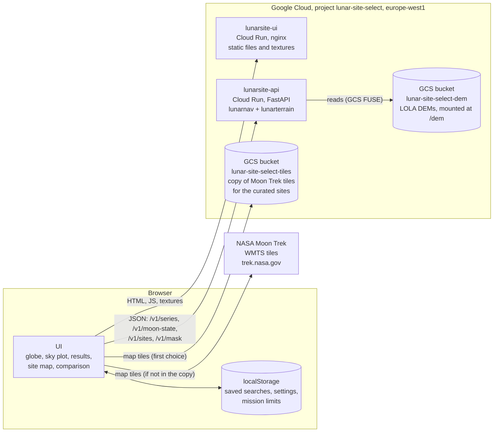
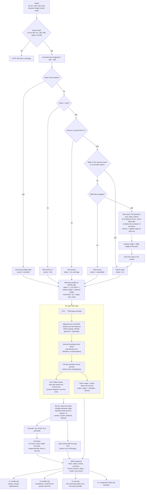

# Architecture, data flow and result checks

This document has three parts:

1. [Architecture and data sources](#1-architecture-and-data-sources): the components, and where each data source enters the system.
2. [From input to result](#2-from-input-to-result): a flowchart of one calculation.
3. [How to check the results](#3-how-to-check-the-results): what a user can do to decide how much to trust a result.

The diagrams use Mermaid. GitHub shows them as diagrams.

---

## 1. Architecture and data sources

### 1.1 Components

| Component | Code | Runs on | Task |
|---|---|---|---|
| UI | `ui/` (Vite, TypeScript, three.js, OpenLayers) | Cloud Run service `lunarsite-ui` (nginx), https://lunarsite.select | Shows the globe, the results (Verdict and Details tabs), the sky plot, the site map, the place search, the saved searches and the comparison. It calculates the verdict, the mission requirements and the landing window from the API results. It does not calculate positions. |
| API | `api/` (FastAPI) | Cloud Run service `lunarsite-api`, https://api.lunarsite.select | Receives requests, gets the horizon mask, runs the core, returns JSON. |
| Core | `core/` (package `lunarnav`) | Inside the API container | Sun and Earth positions, visibility, events and summary. Uses SPICE. |
| Terrain | `data/` (package `lunarterrain`) | Inside the API container | Horizon masks from the LOLA elevation models. |

### 1.2 Deployment and data stores

Inside the API container image:

- the SPICE kernels (downloaded from NAIF when the image is built),
- `data/sites.json` (the curated sites),
- 36 precomputed horizon masks (the south-pole curated sites and two Shackleton points, at 0, 2 and 10 m).

### 1.3 Data sources

There are two kinds of data:

- **Calculation data** changes the numbers in the results.
- **Display data** changes only the images. It has no effect on any number.

| Data source | Kind | Where it is stored | Used by | Effect on the results |
|---|---|---|---|---|
| NAIF leap-second kernel `naif0012.tls` | Calculation | API image | Core | UTC to TDB time conversion |
| JPL planetary ephemeris DE440 (`de440s.bsp`) | Calculation | API image | Core | Positions of the Sun, Earth and Moon |
| DE440 lunar orientation (`moon_pa_de440_200625.bpc`) and frame kernel (`moon_de440_250416.tf`) | Calculation | API image | Core | Orientation of the Moon. Defines the `MOON_ME` frame. |
| Planetary constants `pck00011.tpc` | Calculation | API image | Core | Body constants |
| LOLA DEM `LDEM_80S_20MPP_ADJ` (20 m/pixel, 80–90° S) | Calculation | DEM bucket | Terrain | Horizon mask up to 25 km from the point, and the surface height |
| LOLA DEM `LDEM_60S_120MPP_ADJ` (120 m/pixel, 60–90° S) | Calculation | DEM bucket | Terrain | Horizon mask from 25 km to 150 km |
| Precomputed horizon masks | Calculation | API image | API | The same masks that the DEMs give. They are faster and work without the DEM bucket. |
| `data/sites.json` | Input | API image | API, UI | The curated site points and radii. Each site has its source. |
| NASA Moon Trek tiles (LRO WAC, NAC, LOLA hillshade, Kaguya) | Display | Moon Trek, and a copy in the tile bucket | UI site map | None |
| Slope tiles from `LDEM_80S_20MPP_ADJ` (`data/scripts/make_slope_tiles.py`) | Display | Tile bucket, `slope/` | UI site map | None |
| NASA PGDA product 69 average Sun and Earth visibility (Mazarico et al. 2011), 60 m and 120 m maps | Display | Tile bucket, `illum_sun/` and `illum_earth/` (`data/scripts/make_illum_tiles.py`), and `ui/public/bestpoints.json` (`data/scripts/make_best_points.py`) | UI site map layers, "Best points in this site" list | None. They are 18.6-year averages at ground level. The period results come from the core. |
| IAU/USGS Gazetteer of Planetary Nomenclature (9,087 lunar names, `data/scripts/make_gazetteer.py`) | Input | UI image, `ui/public/gazetteer.json` | UI place search | Only the selected point. The search selects the centre of the feature. |
| CGI Moon Kit (LROC colour, LOLA relief) | Display | UI image | UI globe | None |
| Blue Marble (Earth), SDO/HMI (Sun) | Display | UI image | UI globe | None |
| JPL Horizons | Check | Test fixtures in `core/tests/fixtures/` | Tests | None. It is the independent reference for the validation. |

Credits and links are in the [README](../README.md#data-sources-and-credits).

### 1.4 Where the numbers come from

All numbers in the results panel, the sky plot and the comparison come from the API. The UI does not calculate any Sun or Earth position. The UI calculates three things from the API results: the Verdict ratings (from the `summary` fields), the mission requirements (from the `summary` fields and the user limits) and the next landing window (from one more `/v1/series` call, 60 days from the start, 30-minute steps). The globe uses `/v1/moon-state` at regular steps and interpolates between them (the error is less than 0.01°).

The horizon mask has three possible sources. The API response says which one it used, in `horizon.source` and `horizon.terrain_status`:

| `horizon.source` | `terrain_status` | Meaning | UI tag |
|---|---|---|---|
| `terrain` | `ok` | A LOLA horizon mask | "Terrain (LOLA 20 m)" or "Terrain (LOLA 120 m)" |
| `flat` | `no_coverage` | The point is north of 60° S. The DEMs do not cover it. | Flat horizon |
| `flat` | `unavailable` | The DEMs cover the point, but the server cannot read them | Red tag: "Flat horizon: terrain not available. Results can be wrong." |
| `flat` | `not_requested` | The request asked for no terrain | Flat horizon |
| `provided` | `not_requested` | The request included its own mask | Provided mask |

---

## 2. From input to result

### 2.1 Inputs

| Input | Unit | Note |
|---|---|---|
| Latitude, longitude | degrees | Planetocentric, `MOON_ME`. East longitude, −180 to +360 (the API changes it to −180 to +180). Not exactly ±90°. |
| Site radius | m | Only for the site map circle. The calculation uses the centre point. |
| Start, stop | UTC, ISO 8601 | One instant if start = stop |
| Step | minutes | Sample step. Events are refined to about 1 s by bisection. |
| Observer height | m | Height of the solar panel or antenna above the ground |
| Terrain | `auto` or `none` | `auto` uses the LOLA mask when the DEMs cover the point |

### 2.2 Flowchart

### 2.3 Notes on the flowchart

- **The percentages use the event times, not the step count.** The step controls which short events the tool can see. A Sun or Earth period shorter than one step can be lost. The event times themselves are accurate to about 1 s.
- **The visible Sun fraction treats the horizon as a straight line across the Sun disk.** The Sun disk is about 0.53° wide. The mask has a 0.5° step, so this is a good approximation.
- **Earth is "visible" when its centre is above the horizon.** `earth_margin` tells how far above (or below) the horizon the centre is.
- **The terrain branch runs outside the SPICE lock.** CSPICE is not thread-safe, so all SPICE work goes through one lock, and the API service handles one request at a time.

---

## 3. How to check the results

A user can check a result at four levels. Each level answers a different question.

### 3.1 Is the result based on terrain? (in the tool)

Look at the horizon tag in the results panel and in the comparison table.

- "Terrain (LOLA 20 m)" is the best case.
- "Terrain (LOLA 120 m)" means that the point is north of 80° S. The near horizon is less detailed.
- "Flat horizon" north of 60° S is normal. Near the equator the Sun and Earth rise high, so a flat horizon has a small effect on the results. Large nearby craters or hills can still change the rise and set times.
- **A red "Flat horizon: terrain not available" tag means that you must not use the result** for a polar point. Near the pole, the terrain controls the result.

### 3.2 Are the Sun and Earth positions correct? (independent check with JPL Horizons)

JPL Horizons is the JPL online ephemeris service. It is fully independent of this tool. The project tests use it (see the [README, Validation](../README.md#validation)). The largest difference is 4.5 × 10⁻⁷°.

To check one instant yourself, use the [Horizons web app](https://ssd.jpl.nasa.gov/horizons/app.html) with these settings:

| Setting | Value |
|---|---|
| Ephemeris type | Observer table |
| Target body | Sun (`10`) or Earth (`399`) |
| Observer location | Coordinates on the Moon (`coord@301`), geodetic |
| Site coordinates | East longitude, latitude, height in **km** above the 1737.4 km sphere |
| Time | The UTC instant |
| Table quantity | 4 (apparent azimuth and elevation) |

The height must be the surface height plus the observer height. The tool shows the surface height for terrain points (`horizon.surface_height_m`). For a flat horizon, the default surface height is 0.

Horizons does not know the terrain. Compare only the azimuth and the elevation, not the visibility.

### 3.3 Is the terrain horizon plausible? (in the tool, then with other data)

1. Open the sky plot. The brown area is the terrain horizon. Check that the shape is plausible: a crater floor has a high horizon in all directions, a ridge or rim has a low horizon.
2. Move the time slider. The Sun must disappear when its path goes behind the brown area.
3. Compare with published illumination maps for the south pole. South of 75° S, the site map shows the NASA PGDA product 69 average sunlight and Earth visibility (layers and the "Sun and Earth" tab). Our percentages are for your time span, not for a long-term average. Thus expect the same pattern (high, low, never), not the same number.

Limits of the terrain horizon:

- The DEMs have 20 m and 120 m pixels. Small rocks and boulders near the observer are not in the model.
- The rays end at 150 km. Very far terrain is not included. Near the pole, the curvature of the Moon makes such terrain rarely important.
- The lander or the panel does not shade itself in the model.

### 3.4 Is the result sensitive to my inputs? (in the tool)

A result that changes a lot when an input changes a little is a weak result. Use saved searches and the comparison to test this:

1. **Observer height.** Save the same point at 0 m, 2 m and 10 m. Near the pole, a few metres can add hours or days of Sun.
2. **Position.** Save the point and two or three points 100–500 m away. If the Sun % changes a lot, the landing accuracy matters for this site.
3. **Date.** Save the same point with a 1- or 2-week shift. Use "Days from start" in the comparison.
4. **Terrain.** Compare with `terrain: none` (API only) to see how much the terrain changes the result.
5. **Step.** Use a smaller step to find short periods. The percentages should change only a little.

### 3.5 Known limits of the method

- Earth visibility uses the centre of the Earth, not its edge. Earth is about 1.9° wide as seen from the Moon.
- There is no atmospheric refraction. This is correct for the Moon.
- Time is UTC. A lunar time standard (Coordinated Lunar Time) is in development. It does not change the geometry.
- The site radius is not used in the calculation yet. The result is for the centre point.
- Line of sight to the Earth is not a full communication check. Antenna pattern, power and ground station time are outside the scope.

---

## 4. Possible tool improvements for result checks

The "Check this result" panel is built (Details tab). It gives the data used and links that open JPL Horizons with the same point, height and time. The proposals below are not built.

| Proposal | What the user gets | Size |
|---|---|---|
| Sensitivity button | One click runs the point at ±2 m height and at 4 points 250 m away, and shows the spread of the Sun and Earth % | Medium (overlaps with the radius stretch goal) |
| Horizon profile view | The terrain horizon as a 360° panorama, with the Sun and Earth paths | Small to medium |
